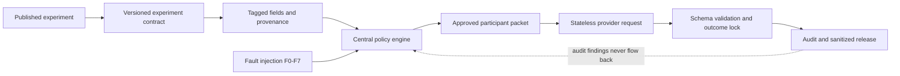

# Causal-firewall-Phase1
This is the zero-cost reproducibility repository for phase 1 of the Causal Firewall project. It packages a reusable information-flow control layer for LLM-based social experiments together with one complete worked example, deterministic fault tests, provider-shaped request audits, and sanitized outcomes.

## Offline command
'python3 scripts/reproduce_study0_offline.py'
The above command runs the curated unit tests, rebuilds the F0-F7 deterministic fault audit, serializes and audits provider-shaped requests without a network client, regenerates the 288-row execution schedule, and verifies the released data against its SHA-256 manifest.

## Study0 Reproduction Path
Step 1: Read this page for the claim and architecture of the proposed model.
Step 2: Run'python3 scripts/reproduce_study0_offline.py'.
Step 3: Read `docs/STUDY0_TECHNICAL_GUIDE.md` for the end-to-end implementation.
Step 4: Inspect `experiments/CF-P1-001/` for the frozen contract and access policy.
Step 5: Inspect `data/CF-P1-001/study0_analysis.json` and the public CSV for the developmental behavioral results.
Step 6: Read `docs/ADAPTING_TO_A_NEW_EXPERIMENT.md` to see what another scholar would replace and what infrastructure remains unchanged.

## What the infrastructure does

The firewall classifies information before model invocation, propagates the most restrictive label through derived-field lineage, checks participant and treatment-arm scope, and denies missing or unregistered information by default. It also separates outcome production from audit and analysis so that later stages cannot rewrite a locked behavioral outcome.

## Study 0 worked example

Study 0 adapts Gordon-Hecker et al. (2017), Experiment 1b. It compares four architectures:

| Architecture | Information carrier | Protection mechanism |
|---|---|---|
| A: monolithic prompt | One all-information packet | Instructions only |
| B: default multi-agent | `handoff_history` | Default handoff behavior |
| C: manual whitelist | Fresh context | Field-name allowlist |
| D: causal firewall | Fresh context | Labels, provenance, scope, and deny-by-default |

The registered fault set covers clean execution, opposite-arm history, restricted lineage hidden in a summary, session reuse, retry contamination, tool-result leakage, auditor backflow, and a missing label.

## Repository map

| Path | Purpose |
|---|---|
| `causal_firewall/` | Reusable policy, architecture, audit, hashing, analysis, and release code |
| `experiments/CF-P1-001/` | Frozen Study 0 contracts and access policy |
| `scripts/` | Zero-cost reproduction and release-verification entry points |
| `tests/` | Curated tests using no paid provider calls |
| `data/CF-P1-001/` | Sanitized outcomes, cell results, metadata, and hashes |
| `docs/` | Technical, reproducibility, audit, and adaptation guides |
| `release/public_release_plan.json` | Explicit allowlist used to build this public preview |

## Reproduction versus replication

The public data and exact request hashes are the durable reproduction path. Calling a provider again is a new replication because model snapshots, provider infrastructure, and stochastic draws can change. A new paid run must receive a new run ID and record its model version, request configuration, cost, and contract hashes.
Paid-run source artifacts, provider response identifiers, local authorization records, credentials, restricted mappings, and phase 2 materials are not part of this repository.
